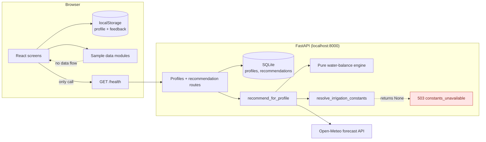
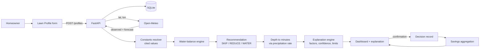
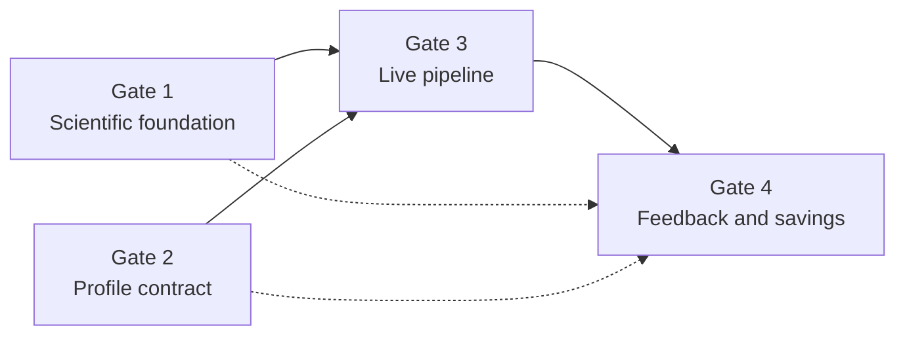

# GreenFlow — Product Requirements Document and Implementation Plan

| Field | Value |
| --- | --- |
| Project | GreenFlow — Smart Lawn Irrigation Advisor |
| Document | PRD + technical implementation plan |
| Version | 0.1 (draft for review) |
| Date | 2026-11-04 |
| Prepared for | Morax (product owner) |
| Basis | Direct inspection of the working tree at `C:\Users\morax\OneDrive\Desktop\enivorment hackathon` |
| Revision control | None. The project directory is not a git repository, so no commit hash can be cited. |

This document is an audit and a plan. No source file, schema, dependency, or component was
changed to produce it. The only file written is this document.

---

## 0. How to read this document

Every capability is tagged with one of the following. The tags are used literally; a component
existing in the tree is never treated as proof that a feature works.

| Tag | Meaning |
| --- | --- |
| **[TESTED]** | Implemented and covered by passing automated tests in this repository. |
| **[NOT INTEGRATED]** | Implemented and tested in isolation, but no production code path calls it. |
| **[PARTIAL]** | Some layers exist; the end-to-end behavior does not. |
| **[MISSING]** | Not implemented. |
| **[SAMPLE]** | Rendered from hard-coded illustrative data that is visibly labeled as sample. |
| **[NEEDS SCIENCE]** | Requires a cited scientific or manufacturer value that is not currently established. |

Evidence commands used for this audit:

```bash
cd "C:/Users/morax/OneDrive/Desktop/enivorment hackathon/backend"
.venv/Scripts/python.exe -m pytest -q          # 68 passed, 1 warning

cd "C:/Users/morax/OneDrive/Desktop/enivorment hackathon/frontend"
npm run build                                   # tsc --noEmit && vite build, passes
```

The one warning is a Starlette deprecation notice about `httpx` in `TestClient`. It is
unrelated to GreenFlow code.

---

## 1. Executive summary

GreenFlow is currently a **high-quality demonstration prototype with a scientifically pure
calculation core that is not connected to the user interface**.

What genuinely exists and works:

- A pure irrigation water-balance engine with explicit inputs, no hidden defaults, and
  68 passing backend tests.
- A FastAPI backend with profile storage, a recommendation orchestration service, a stored
  recommendation record, and a consistent error contract.
- Six polished, responsive frontend surfaces built on one design system, all rendering
  clearly labeled sample data.
- An explicitly honest "cannot recommend" path: because verified irrigation constants are
  not configured, the production recommendation route refuses to invent a result.

What does not exist:

- **No end-to-end recommendation.** The frontend never calls the backend except `/health`.
  Profiles are saved only to `localStorage`; weather, recommendations, and savings are all
  sample modules.
- **No resolved constants.** `resolve_irrigation_constants()` returns `None`, so
  `GET /profiles/{id}/recommendation` always returns HTTP 503 `constants_unavailable`.
- **No live explanation payload.** Reasons, confidence, and limitations are authored in the
  frontend sample module, not generated from computation outputs.
- **No persisted confirmation.** Feedback is written to `localStorage` and is not linked to
  savings.
- **No conversion from millimetres to sprinkler minutes** in any production path.

The single most important blocker is **Gate 1: scientifically cited constants**. Until those
values exist, every other integration step would either be blocked or would produce numbers
that cannot be defended. The second blocker is **Gate 2: profile contract alignment**, because
the frontend profile lacks location, last-watering history, and sprinkler delivery rate — all
required by the existing backend schema.

**Recommended first implementation task:** Gate 1, Task G1-1 — transcribe and cite the
FAO-56 Table 19 soil-water values for the four soil options the app offers, then implement a
`backend/app/engine/constants.py` module that maps the saved profile to a fully cited
`IrrigationConstants`. Nothing downstream should start before that.

---

## 2. Product scope

### 2.1 Product definition

GreenFlow helps homeowners who already own a conventional sprinkler timer decide whether to
run, shorten, or skip the next scheduled watering cycle. It combines local weather data with a
root-zone water balance and returns one of three advisory states:

- **SKIP** — do not run the scheduled cycle.
- **REDUCE** — run a shorter cycle.
- **WATER** — follow the normal schedule.

The homeowner always makes the final decision and manually operates the existing timer.
GreenFlow never turns sprinklers on or off, and no screen claims that it does.

### 2.2 In scope

- Lawn profile capture (area, grass, soil, sprinkler, schedule, last watering, location).
- Local weather retrieval and display (observed and forecast, clearly separated).
- Root-zone water balance and a SKIP / REDUCE / WATER recommendation.
- An explanation of the recommendation built from the actual calculation inputs and outputs.
- Optional homeowner confirmation of what they did.
- Estimated water avoided relative to the user's stated baseline schedule.

### 2.3 Non-goals

- Automatic sprinkler control, valve control, or any hardware integration.
- Agricultural or farm-scale irrigation management.
- A replacement for a professional irrigation audit or soil-moisture measurement.
- Machine learning, LLM-generated advice, or predictive maintenance.
- Multi-zone, multi-property, or commercial landscaping management.
- Guaranteed water savings, measured water savings, or utility-bill predictions.

### 2.4 Success criteria for the hackathon demo

These are demo criteria, not proven environmental outcomes. No field validation exists.

1. A saved profile produces a real recommendation from live Open-Meteo data and cited
   constants, with no sample fallback in the critical path.
2. Each displayed factor is traceable to a value the engine actually consumed.
3. Normal and recommended durations are shown in minutes, derived from the profile's delivery
   rate, with the depth calculation visible.
4. Confidence is qualitative and its basis is explained; no invented percentages.
5. Confirmation is recorded and clearly distinguished from an automatic control action.
6. Any savings figure is labeled **estimated**, shows the baseline, and reports volume only
   when a delivery rate or area is available.
7. Every limitation listed in Section 8.6 is visible in the product.

---

## 3. Existing implementation audit

### 3.1 Repository map

```
enivorment hackathon/
├── backend/
│   ├── app/
│   │   ├── main.py                     FastAPI app, CORS, routers, lifespan
│   │   ├── api/
│   │   │   ├── errors.py               ApiError, ErrorResponse, exception handlers
│   │   │   ├── health.py               GET /health
│   │   │   ├── profiles.py             POST/GET/PATCH profile schemas and routes
│   │   │   └── recommendations.py      GET /profiles/{id}/recommendation
│   │   ├── db/
│   │   │   ├── database.py             engine, SessionLocal, Base, init_db, get_db
│   │   │   ├── models.py               Profile, Recommendation tables
│   │   │   ├── profiles.py             create_profile, get_profile, update_profile
│   │   │   └── recommendations.py      create_recommendation
│   │   ├── engine/
│   │   │   ├── models.py               EngineConfig, EngineDay, IrrigationConstants, results
│   │   │   ├── water_balance.py        TAW/RAW, depletion, horizon, recommend
│   │   │   └── savings.py              estimate_savings
│   │   └── services/
│   │       ├── open_meteo.py           fetch_daily_weather + normalization
│   │       └── recommendation.py       orchestration + constants resolver
│   ├── tests/                          68 passing tests
│   ├── lawn_advisor.db                 SQLite database (default URL)
│   ├── pyproject.toml                  ruff + pytest config
│   └── requirements.txt
├── context/                            project, calculation, UI and workflow docs
├── docs/                               this document and existing drafts
└── frontend/
    ├── src/
    │   ├── App.tsx                     hash routing
    │   ├── api/health.ts               the only live API call in the UI
    │   ├── pages/                      Dashboard, LawnSetup, Weather, Savings, Recommendation
    │   ├── sample/                     five hard-coded sample datasets
    │   ├── components/                 shared UI and chart components
    │   ├── lib/                        storage, weather formatting, feedback
    │   └── styles/, global.css         design tokens
    └── dist/                           current production build
```

### 3.2 Backend inventory

| Area | File and symbol | Status | Notes |
| --- | --- | --- | --- |
| App wiring | `backend/app/main.py` | **[TESTED]** | Lifespan calls `init_db()`. CORS allows `http://localhost:5173`, `http://127.0.0.1:5173`, methods GET/POST/PATCH. |
| Health | `backend/app/api/health.py::get_health` | **[TESTED]** | Returns `{"status": "ok"}`. |
| Error contract | `backend/app/api/errors.py` | **[TESTED]** | `ApiError`; validation mapped to 400 `invalid_request`; 404 `profile_not_found` or `not_found`. |
| Profile schemas | `backend/app/api/profiles.py::ProfileFields` | **[TESTED]** | All 12 fields required on create; `extra="forbid"`. |
| Profile persistence | `backend/app/db/profiles.py` | **[TESTED]** | UUID4 server-generated ID; partial update only touches the addressed row. |
| Recommendation route | `backend/app/api/recommendations.py::get_recommendation` | **[TESTED]** | Returns a stored recommendation or 503 with a `CannotRecommendResponse`. |
| Orchestration | `backend/app/services/recommendation.py::recommend_for_profile` | **[TESTED]** | Loads weather, builds `EngineConfig`, walks observed days, runs engine, stores inputs and result. |
| Constants resolver | `backend/app/services/recommendation.py::resolve_irrigation_constants` | **[MISSING]** | Returns `None` unconditionally. This is the hard blocker. |
| Weather client | `backend/app/services/open_meteo.py::fetch_daily_weather` | **[TESTED]** | One forecast-endpoint call, `past_days=7`, `forecast_days=7`, `timezone=auto`. |
| Water balance | `backend/app/engine/water_balance.py` | **[TESTED]** | Pure functions, no framework imports, explicit inputs only. |
| Savings | `backend/app/engine/savings.py::estimate_savings` | **[NOT INTEGRATED]** | Unit-tested, never called by a route or service. |
| Database | `backend/app/db/database.py` | **[TESTED]** | Default `sqlite:///./lawn_advisor.db`; tables created with `create_all`; no migration tool. |

### 3.3 Frontend inventory

| Area | File | Status | Data source |
| --- | --- | --- | --- |
| Routing | `frontend/src/App.tsx` | **[TESTED]** | Hash routes: `#dashboard`, `#lawn-profile`, `#weather-intelligence`, `#water-savings`, `#recommendation`. |
| Dashboard | `frontend/src/pages/DashboardPage.tsx` | **[SAMPLE]** | `sampleDashboard`, `sampleWeather`, sample recommendation and savings preview. |
| Lawn profile | `frontend/src/pages/LawnSetupPage.tsx` | **[PARTIAL]** | Reads/writes `lawnProfileStorage`; no API call; no location or last-watering fields. |
| Weather Intelligence | `frontend/src/pages/WeatherIntelligencePage.tsx` | **[SAMPLE]** | `sampleWeather`; loading/error/empty controls are local. |
| Water Savings | `frontend/src/pages/WaterSavingsPage.tsx` | **[SAMPLE]** | `sampleSavings`; explicitly states a 10 L/min sample flow rate and 30-minute sample baseline. |
| Recommendation explanation | `frontend/src/pages/RecommendationExplanationPage.tsx` | **[SAMPLE]** | `sampleRecommendation` + `localStorage` feedback. |
| API client | `frontend/src/api/health.ts` | **[PARTIAL]** | Only `/health` is called anywhere in the UI. |
| Profile storage | `frontend/src/lib/lawnProfileStorage.ts` | **[TESTED]** | Key `greenflow.lawn-profile.v1`; runtime shape validation. |
| Feedback storage | `frontend/src/lib/recommendationFeedback.ts` | **[TESTED]** | Key `greenflow.recommendation-feedback.v1`; keyed by `date:state`. |
| Unused pages | `frontend/src/pages/TodayPage.tsx`, `frontend/src/pages/StatusPage.tsx` | **[MISSING]** | Not referenced by `App.tsx`; dead code. |

### 3.4 Verification evidence

| Check | Result |
| --- | --- |
| Backend test suite | **68 passed**, 1 unrelated deprecation warning, 0.82 s |
| Frontend production build | Passes: 2483 modules; JS 791.97 kB (225.19 kB gzip); CSS 105.89 kB (16.44 kB gzip); only the chunk-size warning |
| Frontend automated tests | **None in the repository.** No test runner is configured in `frontend/package.json`. |
| Browser QA for Screen 4 | 154/154 checks in a temporary CDP harness outside the repo (`%TEMP%/greenflow-rec-qa`); not committed, not reproducible from the repo alone |
| Live API check | `GET http://127.0.0.1:8000/health` returns 200 `{"status":"ok"}` |

---

## 4. Feature-by-feature status

### 4.1 Lawn Profile

- **Frontend:** `frontend/src/pages/LawnSetupPage.tsx`, `frontend/src/types/lawnProfile.ts`,
  `frontend/src/lib/lawnProfileStorage.ts`, `frontend/src/data/lawnSetupOptions.ts`.
- **Captured fields:** `lawnArea` (`value`, `unit`, derived `areaM2`), `grassType`, `soilType`,
  `sprinklerType`, `wateringDurationMinutes`, `wateringFrequency`, `savedAt`.
- **Not captured:** location label, latitude, longitude, last watered date, last watered
  minutes, sprinkler precipitation rate, numeric events per week, flow rate.
- **Backend:** `POST /profiles`, `GET /profiles/{id}`, `PATCH /profiles/{id}` with the full
  12-field schema; `Profile` table in `backend/app/db/models.py`.
- **Persistence:** browser `localStorage` only. No profile ID is ever created or stored.
- **Frequency mapping:** the UI offers ranges ("2–3 times per week", "4–5 times per week") and
  "Custom schedule". The backend requires an integer `events_per_week`. No mapping exists.
- **Status:** **[PARTIAL]** — a complete UI form and a complete backend schema that do not
  share a contract.
- **Missing for end-to-end:** location, last watering, delivery rate, numeric frequency,
  API persistence, profile ID reuse.

### 4.2 Weather Intelligence

- **Frontend:** `frontend/src/pages/WeatherIntelligencePage.tsx`,
  `frontend/src/components/greenflow/weather/*`, `frontend/src/sample/sampleWeather.ts`.
- **Backend:** `backend/app/services/open_meteo.py`.
- **Variables retrieved by the client:** `precipitation_sum`, `temperature_2m_max`,
  `temperature_2m_min`, `wind_speed_10m_max`, `et0_fao_evapotranspiration`.
- **Variables shown in the UI but not retrieved:** current temperature, current humidity
  (`62%` in the sample), daily rain probability, wind gust, "current conditions".
- **Status:** **[SAMPLE]** in the UI, **[TESTED]** and **[NOT INTEGRATED]** in the backend.
- **Missing for end-to-end:** a frontend client method, a response shape for current
  conditions and probability, freshness metadata, and failure-to-UI mapping.

### 4.3 Smart Watering Calculator

- **Backend calculation:** `compute_taw`, `compute_raw`, `depletion_after_watering`,
  `compute_horizon`, `effective_rainfall`, `update_depletion`, `project_forecast`,
  `recommend` in `backend/app/engine/water_balance.py`; specification in
  `context/calculation-spec.md`.
- **Frontend:** no dedicated calculator screen. The recommendation explanation screen shows
  normal/recommended durations and a depth bar, but from sample data.
- **Status:** **[TESTED]** as a pure engine; **[MISSING]** as a callable product surface.
- **Missing for end-to-end:** resolved constants, runtime conversion, a UI that displays the
  calculation inputs/outputs, and any call path from the app.

### 4.4 Daily Recommendation

- **Backend:** `recommend_for_profile` + `GET /profiles/{id}/recommendation`. Produces
  `SKIP`/`REDUCE`/`WATER`, recommended depth in mm, reason string, `why` numbers, uncertainty,
  assumptions, and a stored record.
- **Frontend:** dashboard recommendation card and the Screen 4 hero, both **[SAMPLE]**.
- **Status:** **[NOT INTEGRATED]**.
- **Missing for end-to-end:** constants (blocks all calls), API client, duration conversion,
  and a profile ID. In practice every live call today returns 503.

### 4.5 Explainable Recommendation Dashboard

- **Frontend:** `RecommendationExplanationPage.tsx`, `sampleRecommendation.ts`,
  `recommendationExplanation.ts`, `RecommendationExplanationPage.css`; entry points from the
  dashboard ("See why", "Full explanation").
- **What is honest today:** factors for soil and grass are explicitly labeled
  "Profile context — not applied"; confidence is qualitative; a visible banner states the
  production engine cannot currently recommend.
- **Status:** **[SAMPLE]** presentation; **[MISSING]** backend explanation engine.
- **Missing for end-to-end:** a structured explanation payload generated from the stored
  recommendation record (Section 13), and factor attribution that comes from the engine.

### 4.6 Water Savings and Environmental Impact

- **Frontend:** `WaterSavingsPage.tsx`, `savings/SavingsCharts.tsx`, `sampleSavings.ts`,
  `types/savings.ts`. Uses a stated 10 L/min sample flow rate, 30-minute sample baseline, and
  90 days of sample history.
- **Backend:** `estimate_savings` in `engine/savings.py`, 10 tests, never called; no savings
  endpoint; no decision/feedback table.
- **Status:** **[TESTED]** engine, **[NOT INTEGRATED]**, UI **[SAMPLE]**.
- **Missing for end-to-end:** persisted recommendations, persisted confirmations, actual
  runtime, confirmed-only aggregation, and an API.

---

## 5. Current architecture



Solid lines are real calls. The engine, database, and weather client work; the browser never
reaches them.

---

## 6. Intended architecture



The explanation engine is a server-side projection of stored calculation inputs. It must not
be able to say anything the engine did not compute.

---

## 7. Data-flow audit

Legend: **Existing** = what the repository does today; **Missing** = what the pipeline needs;
**Failure** = what can go wrong.

### Stage 1 — Homeowner input

| Aspect | Detail |
| --- | --- |
| Input | Lawn area and unit, grass, soil, sprinkler, duration, frequency |
| Processing | Client-side validation and unit conversion in `LawnSetupPage.tsx` (`areaM2`) |
| Output | `LawnProfile` object in `localStorage` |
| Existing | Form and storage work |
| Missing | Location, last-watered date/minutes, delivery rate, numeric frequency, server persistence |
| Failure | `localStorage` unavailable/quota → save state `error`; data lost on another browser or device; "Custom schedule" cannot produce `events_per_week`; "Not sure" soil/sprinkler has no mapping |

### Stage 2 — Profile persistence

| Aspect | Detail |
| --- | --- |
| Input | Profile JSON |
| Processing | `create_profile` validates and inserts with a UUID4 |
| Output | `ProfileResponse` including `id` |
| Existing | Endpoint and tests exist |
| Missing | No frontend call; no stored `profile_id`; no auth; no list endpoint |
| Failure | 400 `invalid_request` for any missing field or unknown property; 404 on unknown ID; no migration path if the schema changes (`create_all` does not alter existing SQLite tables) |

### Stage 3 — Live weather

| Aspect | Detail |
| --- | --- |
| Input | Latitude, longitude |
| Processing | `fetch_daily_weather` → `_normalize_daily` → `_require_values` |
| Output | 14 `WeatherDay` records, 7 observed + 7 "forecast" (today onward) |
| Existing | Fully tested against mocked HTTP |
| Missing | No caching, freshness metadata, current conditions, humidity, probability, retry, or attribution in the UI |
| Failure | 10 s timeout; any connection error; any HTTP status ≠ 200; malformed JSON; any `null` value; any unexpected series length → `WeatherUnavailableError` → 503. One missing value fails the entire request. Past days are model data from the forecast endpoint, not a station measurement. |

### Stage 4 — Water-balance engine

| Aspect | Detail |
| --- | --- |
| Input | `EngineConfig` + observed days + forecast days |
| Processing | Initial depletion from last watering, observed walk, horizon, forecast projection, decision |
| Output | State, recommended depth, TAW, RAW, skip threshold, horizon, projected depletions |
| Existing | 24 engine tests |
| Missing | Constants; soil/grass differentiation; mm→minutes |
| Failure | `EngineInputError` on invalid inputs; 503 when constants are missing; 503 when the last watering date is outside the 7-day observed window; 503 when forecast days < horizon |

### Stage 5 — Recommendation

| Aspect | Detail |
| --- | --- |
| Input | Engine result + profile + constants |
| Processing | `_reason_for`, `_assumptions_for`; row stored by `create_recommendation` |
| Output | Persisted recommendation with `why` numbers |
| Existing | Orchestration and route tested |
| Missing | Runtime minutes, factors array, confidence, data freshness, history endpoint |
| Failure | Every `GET` writes a new row (a read has side effects); repeated refreshes create duplicates; no deduplication or idempotency key |

### Stage 6 — Explanation

| Aspect | Detail |
| --- | --- |
| Input | Stored recommendation row |
| Processing | None today beyond three sentence templates |
| Output | `reason`, `uncertainty`, `assumptions` strings |
| Existing | Strings stored |
| Missing | Structured factors, confidence basis, missing-input list, weather summary |
| Failure | The UI cannot distinguish "used by the engine" from "shown as context"; today it does this by hand-authored labels, which will not scale |

### Stage 7 — Confirmation

| Aspect | Detail |
| --- | --- |
| Input | One of three choices |
| Processing | `saveFeedback` writes to `localStorage` |
| Output | Entry keyed by `date:state` |
| Existing | Works locally |
| Missing | Server record, profile scoping, actual runtime, link to a recommendation ID |
| Failure | Lost on cache clear; two profiles on one browser collide; cannot feed savings; "followed" is self-report, never proof |

### Stage 8 — Savings analytics

| Aspect | Detail |
| --- | --- |
| Input | Baseline depth, events/week, window, area, recommended depths, efficiency |
| Processing | `estimate_savings` |
| Output | Baseline volume, recommended volume, estimated avoided volume, assumptions |
| Existing | 10 engine tests |
| Missing | Any call path; confirmed-action aggregation; API; UI wiring |
| Failure | No flow rate → no defensible litre figure; no measurements → minutes-only reporting; claimed savings would be unverifiable |

### 7.1 Disconnected components (exhaustive)

1. `fetch_daily_weather` ← never called by the browser; only by `recommend_for_profile`.
2. `recommend_for_profile` ← unreachable in practice because constants are `None`.
3. `estimate_savings` ← no caller in application code.
4. `POST /profiles`, `GET /profiles/{id}`, `PATCH /profiles/{id}` ← no frontend client.
5. `lawnProfileStorage` ↔ backend `Profile` ← different shapes, no bridge.
6. `recommendationFeedback` ↔ `WaterSavingsPage` ← feedback is never read by savings.
7. `sampleWeather` / `sampleRecommendation` ↔ engine ← similar concepts, unrelated code.

---

## 8. Scientific calculation methodology

### 8.1 Units and conventions

- Depths: millimetres (mm). ET₀: mm/day. Areas: m². Volumes: litres (L).
- 1 mm of water over 1 m² equals 1 L (structural unit identity, not a scientific constant).
- Temperatures: °C. Wind: m/s. Time: dates in the weather location's time zone for weather
  records; UTC for `Recommendation.created_at`.

### 8.2 Implementation as it exists

The engine implements the equations in `context/calculation-spec.md`:

```
TAW = (theta_fc - theta_wp) * Zr * 1000          compute_taw
RAW = p * TAW                                     compute_raw
ETc_t = Kc * ET0_t                                update_depletion
P_eff_t = min(P_t, max(0, D_{t-1}))               effective_rainfall
D_t = clamp(D_{t-1} + ETc_t - P_eff_t - I_t, 0, TAW)
H = min(H_cap, max(1, ceil(7 / n_base)))          compute_horizon
D_start = clamp(RAW - I_last, 0, TAW)             depletion_after_watering
T_skip = f_skip * RAW
I_rec = min(D_proj_max / eff_irrigation, I_max)
```

Decision order: `D_proj_max <= T_skip` → SKIP; else `I_rec >= I_base_event` → WATER;
otherwise REDUCE. `D_proj_max` excludes today's depletion by design (see Section 4 of the
calculation spec, which explains the dry-lawn-plus-rain regression test).

These equations match the FAO-56 root-zone water-balance structure, with the simplifications
listed in 8.5.

### 8.3 Runtime conversion (not implemented)

The engine returns an applied depth. To advise a timer owner:

```
runtime_minutes = recommended_depth_mm / precipitation_rate_mm_per_hour * 60
precipitation_rate_mm_per_hour = 60 * sprinkler_flow_l_per_min / irrigated_area_m2
```

Both are structural identities, not scientific constants. Requirements:

- `precipitation_rate_mm_per_hour` must come from the user, a manufacturer chart, or a
  catch-cup measurement — never a silent default.
- The engine divides by `eff_irrigation`, so `I_rec` is already a gross applied depth;
  runtime must not divide by efficiency again.
- Duration should be rounded to the timer's resolution (usually 1 minute). The rounding rule
  is a product decision, not a scientific one.
- If the computed runtime exceeds the user's normal event, the UI must say "at least", not
  silently cap at the normal duration. See the WATER-state ambiguity in Section 12.5.

### 8.4 Savings methodology as implemented

```
N_base_events = n_base * N_days / 7
V_base = I_base_event * N_base_events * A
V_rec  = sum(recommended_depth_d) * A
V_avoided = max(0, V_base - V_rec)
```

`estimate_savings` reports the baseline event depth, events per week, events in the window,
window length, area, efficiency, both volumes, the estimate, and four assumption strings. It
never uses the word "saved"; it reports "estimated water avoided". This is the **recommended**
tier, not the **confirmed** tier (Section 14).

### 8.5 Deliberate simplifications and departures from FAO-56

These are scientific limitations, not bugs. They must be visible in the product.

| Simplification | Consequence |
| --- | --- |
| Single crop coefficient `Kc`, not the FAO-56 dual coefficient (`Kcb + Ke`) | Evaporation from a wet soil surface is not modelled separately; frequent shallow watering is not represented. |
| One constant `Kc` for the whole season | FAO-56 provides `Kc ini`, `Kc mid`, `Kc end`; the engine cannot vary Kc by season or growth stage. |
| No climate adjustment of `Kc` | FAO-56's wind/humidity adjustment is not applied; the backend does not fetch humidity. |
| Effective rainfall = `min(P, D_prev)` | No USDA-SCS effective-rainfall formula, no intensity/runoff limit, no infiltration-rate limit. Heavy rain is assumed to refill only to the current depletion and the rest drains. |
| Rainfall assumed spatially uniform over the lawn | Rain gauge/model grid values can differ from on-site rainfall. |
| Initial depletion assumes the root zone was at RAW before the last watering | The starting state is an assumption, not a measurement. |
| No irrigation on forecast days | Assumes the user will not water before the next scheduled cycle. |
| No soil-moisture measurement | The model is a bookkeeping estimate, not a sensor reading. |
| Sprinkler uniformity not modelled | `eff_irrigation` is a single scalar; distribution uniformity and per-zone differences are ignored. |
| Forecast ET₀ and rain are model outputs | They are not measurements and can change after the recommendation is shown. |

### 8.6 Required user-visible limitations

These seven statements already exist in `frontend/src/sample/sampleRecommendation.ts` as
`recommendationLimitations`. They must eventually come from the explanation payload, not from
a frontend constant.

1. ET₀ is a reference evapotranspiration rate, not the exact water requirement of every lawn.
2. Rainfall measurements may differ from the rain that actually reached the lawn.
3. Weather forecasts can change after the recommendation is shown.
4. Soil conditions and drainage vary across a lawn and may differ from the saved profile.
5. Sprinkler output may not be uniform because of pressure, spacing, or clogged heads.
6. GreenFlow provides guidance, not a direct measurement of soil moisture.
7. Local conditions (shade, slope) should be considered before changing the watering plan.

---

## 9. Required constants and evidence sources

### 9.1 What has been verified for this document

Verified on 2026-11-04 from the FAO-56 chapter pages:

- **FAO-56 Table 12 (single crop coefficients):** cool-season turfgrass
  `Kc ini = 0.90`, `Kc mid = 0.95`, `Kc end = 0.95`; warm-season turfgrass
  `Kc ini = 0.80`, `Kc mid = 0.85`, `Kc end = 0.85`. A footnote (15) applies to the turf rows.
- **FAO-56 Table 22 (depletion fraction):** turfgrass `p = 0.40` (cool season) and
  `p = 0.50` (warm season).

Not verified here: **FAO-56 Table 19** soil-water rows. The HTML chapter references Table 19
but does not render its contents as text, and the PDF extraction available in this environment
did not return the table. Those rows must be transcribed from the official PDF and cited
before use. **Do not copy values from memory or secondary blog posts.**

### 9.2 Constant register

| Symbol / parameter | Meaning | Source | Variability | MVP approach | Uncertainty / status |
| --- | --- | --- | --- | --- | --- |
| `Kc` | Crop coefficient converting ET₀ to lawn ETc | FAO-56 Table 12 (turfgrass rows) | Grass type (cool vs warm season), season | Map each supported grass to a season class; use a single documented Kc; record which table row was used | **[NEEDS SCIENCE]** — selection of ini/mid/end and intra-season variation must be decided |
| `theta_fc` | Volumetric water content at field capacity | FAO-56 Table 19 by USDA texture | Soil texture, compaction, organic matter | Transcribe the row matching the saved soil type | **[NEEDS SCIENCE]** — values not yet transcribed |
| `theta_wp` | Volumetric water content at permanent wilting point | FAO-56 Table 19 by USDA texture | Soil texture | Same row as `theta_fc` | **[NEEDS SCIENCE]** |
| `Zr` | Effective turf root depth (m) | FAO-56 Chapter 8 rooting-depth ranges; species-specific extension publication required | Grass species, soil, management | One cited value per supported grass class, with a documented range | **[NEEDS SCIENCE]** — no species-specific citation in repo |
| `p` | Depletion fraction at stress onset | FAO-56 Table 22 | Cool vs warm season | 0.40 cool, 0.50 warm | Verified values; mapping to grass classes still needed |
| `f_skip` | Fraction of RAW below which SKIP is allowed | Product policy; no scientific source | Product risk tolerance | Must be set with a written rationale; not a scientific constant | **[NEEDS SCIENCE / POLICY]** |
| `eff_irrigation` | Fraction of applied water reaching the root zone | System-specific; ASABE residential uniformity study reports average DU ≈ 0.49 for non-agricultural turf sprinklers | Sprinkler type, pressure, spacing, maintenance | Prefer a measured catch-cup value; otherwise a cited conservative value with confidence downgraded | **[NEEDS SCIENCE]** — efficiency ≠ uniformity; do not treat 0.49 as a universal efficiency |
| `I_max` | Maximum depth recommended in one event | Product policy | Timer and soil infiltration limits | Cap at a value the user's system can apply without runoff; document rationale | **[NEEDS SCIENCE / POLICY]** |
| `H_cap` | Decision-horizon cap in days | Structural (client requests 7 forecast days) | — | 7 (already an assumption in the spec) | Documented assumption |
| `PR` | Sprinkler precipitation rate (mm/h) | Manufacturer chart, catch-cup test, or `60 × flow / area` | Nozzle, pressure, spacing, head type | User input; no silent per-type defaults | **[NEEDS SCIENCE]** — no universal value |
| `n_base` | Baseline events per week | User input | — | Ask for an exact integer, not a range | Currently unmapped from the UI |
| `N_days` | Savings window | Product decision | — | Choose 7/30/90 and state it | Decision needed from Morax |
| `1000`, `7`, `60` | Unit conversions (mm/m, days/week, min/h) | Structural | — | Hard-coded as structural | Not scientific constants |

### 9.3 How to select the values (method, not values)

1. **Grass → season class.** Warm-season candidates in the UI: bermuda, zoysia,
   St. Augustine. Cool-season candidates: Kentucky bluegrass, fescue. "Other" must either ask
   the user to choose a class or return a low-confidence/cannot-recommend result.
2. **Soil → texture row.** The UI offers sandy, clay, loamy, silty, "not sure". FAO-56 Table 19
   uses USDA texture classes; loamy maps to loam, silty to silt loam, and sandy/clay need an
   explicit choice (sandy loam vs sand; clay vs clay loam). "Not sure" must lower confidence,
   not silently pick a row.
3. **Root depth.** Use a cited species/class value. If only a range is available, choose a
   documented point (for example the lower bound, which is conservative for plant health) and
   store the citation and the range with the constant.
4. **Efficiency.** If the user cannot provide a measured value, use a cited value and mark
   the recommendation confidence lower. Do not present an assumed efficiency as measured.
5. **`f_skip` and `I_max`.** Write a short policy rationale in the constants module. They are
   product choices that shape how aggressively GreenFlow recommends skipping; they are not
   derived from FAO-56.

### 9.4 Missing evidence that must be obtained before Gate 3

- FAO-56 Table 19 rows for the soil options the UI exposes.
- A species-specific turf root-depth citation.
- A defensible irrigation-efficiency value or decision to require measurement.
- A rationale for `f_skip` and `I_max`.
- A decision on `Kc` season handling (single value vs ini/mid/end).

---

## 10. Frontend/backend contract

### 10.1 Current mismatch

| Concept | Frontend (`types/lawnProfile.ts`) | Backend (`ProfileFields`) | Gap |
| --- | --- | --- | --- |
| Identity | none | `id` (UUID4) | No ID stored or reused |
| Location label | none | `location_label` (1–120 chars) | Missing |
| Coordinates | none | `latitude`, `longitude` | Missing |
| Lawn area | `lawnArea.value` + `unit` + `areaM2` | `lawn_area_m2` > 0 | Convertible |
| Grass | `GrassTypeId` union | free string 1–80 | No shared enum |
| Soil | `SoilTypeId` union | free string 1–80 | No shared enum |
| Sprinkler | `SprinklerTypeId` union | free string 1–80 | No shared enum |
| Normal duration | `wateringDurationMinutes` | `baseline_minutes_per_event` > 0 | Rename only |
| Frequency | `WateringFrequencyId` ranges | `events_per_week` integer > 0 | Not derivable for "custom" |
| Last watered date | none | `last_watered_date` | Missing |
| Last watered minutes | none | `last_watered_minutes` > 0 | Missing |
| Precipitation rate | none | `precipitation_rate_mm_per_hour` > 0 | Missing |
| Flow rate | none | not stored (derivable) | Missing |

### 10.2 Proposed profile contract

Keep the backend's 12 fields, with these additions and clarifications:

- `grass_type`, `soil_type`, `sprinkler_type` should be **closed enums shared by both sides**,
  not free strings. Free strings make silent mismatches possible.
- Add `flow_l_per_min` as an optional field. If present, the backend derives
  `precipitation_rate_mm_per_hour = 60 × flow / area` and records which source was used.
  If absent, `precipitation_rate_mm_per_hour` is required.
- Add `frequency_source` or replace the range select with an exact integer
  `events_per_week`. Ranges cannot be mapped without inventing a rule.
- "Not sure" values must be representable. Recommended: store `"unknown"` and return a
  lower-confidence recommendation, or refuse if the constant cannot be resolved.

Example request (illustrative values, not results):

```json
{
  "location_label": "Riverside Lawn",
  "latitude": 37.7749,
  "longitude": -122.4194,
  "lawn_area_m2": 120.0,
  "grass_type": "tall_fescue",
  "soil_type": "loam",
  "sprinkler_type": "rotor",
  "precipitation_rate_mm_per_hour": 12.0,
  "flow_l_per_min": 24.0,
  "baseline_minutes_per_event": 30,
  "events_per_week": 3,
  "last_watered_date": "2026-11-03",
  "last_watered_minutes": 30
}
```

Response adds `id` and echoes all fields.

### 10.3 Required, optional, derived, and unknown

| Field | Required? | Source | Handling of unknown |
| --- | --- | --- | --- |
| Location label | Required | User | — |
| Latitude/longitude | Required | User selection or geocoding | Cannot recommend without weather |
| Lawn area | Required for savings; required by current schema | User | Area unit conversion is structural |
| Grass type | Required for Kc | User | "Not sure" → cannot resolve Kc → low confidence or cannot recommend |
| Soil type | Required for θFC/θWP | User | "Not sure" → cannot resolve TAW → low confidence or cannot recommend |
| Sprinkler type | Required for PR default (if any) | User | "Not sure" → require measured PR |
| Precipitation rate | Required, or derived from flow + area | Manufacturer chart / catch-cup / flow | If absent and flow absent → minutes cannot be computed |
| Normal duration | Required | User | — |
| Events per week | Required | User | Replace ranges with an integer |
| Last watered date | Required | User | Must fall inside the observed window, else cannot recommend |
| Last watered minutes | Required | User | — |

### 10.4 Unknown-handling rule

Unknown is a first-class value, never a silent default. The product must choose one of:

1. Refuse to recommend (safest; matches the engine's existing philosophy).
2. Recommend with a lowered confidence label and a visible "missing information" list.

Do not use a default constant for a "not sure" answer unless the default is cited and the
confidence label reflects it.

---

## 11. API integration plan

### 11.1 Existing endpoints

| Method | Path | Request | Success | Failures |
| --- | --- | --- | --- | --- |
| GET | `/health` | — | 200 `{"status":"ok"}` | — |
| POST | `/profiles` | `ProfileCreate` (12 fields) | 201 `ProfileResponse` with `id` | 400 `invalid_request` |
| GET | `/profiles/{profile_id}` | — | 200 `ProfileResponse` | 404 `profile_not_found` |
| PATCH | `/profiles/{profile_id}` | `ProfileUpdate` (≥1 non-null field) | 200 `ProfileResponse` | 400 `invalid_request`, 404 `profile_not_found` |
| GET | `/profiles/{profile_id}/recommendation` | — | 200 `RecommendationResponse` | 404 `profile_not_found`; 503 `CannotRecommendResponse` |

`CannotRecommendResponse` shape: `{"state": "CANNOT_RECOMMEND", "code": "...", "reason": "...",
"message": "..."}`. Current codes: `constants_unavailable`, `weather_unavailable`,
`last_watering_out_of_range`, `insufficient_forecast`.

### 11.2 Required additions

| Method | Path | Purpose |
| --- | --- | --- |
| GET | `/profiles/{profile_id}/recommendations?limit=` | History for the savings screen |
| POST | `/profiles/{profile_id}/recommendations/{recommendation_id}/feedback` | Persist confirmation and actual action |
| GET | `/profiles/{profile_id}/savings?window_days=` | Server-computed savings tiers |

Design notes:

- **Recommendation `GET` currently has side effects.** Every successful call inserts a row.
  Make generation idempotent per `(profile_id, local_date)` or move generation to an explicit
  `POST /profiles/{id}/recommendations:generate`. A refresh should not create a second
  recommendation.
- **Add freshness metadata** to the recommendation response: `weather_retrieved_at`,
  `observed_through`, `forecast_through`, and the weather location's time zone.
- **Do not add auth in the hackathon** unless the demo requires it, but document that profile
  UUIDs are the only access control and that anyone holding an ID can read and patch it.
- **CORS** is limited to two localhost origins. Add the preview origin if the built app is
  demonstrated from `127.0.0.1:4173`.

### 11.3 API surface for the explanation

The explanation should be returned with the recommendation, not assembled by the UI. See
Section 13 for the proposed shape.

---

## 12. Recommendation-engine specification

### 12.1 Pipeline (as intended)

1. Load the profile by ID (`get_profile`).
2. Resolve constants (`resolve_irrigation_constants(profile)`); fail with
   `constants_unavailable` if any required value cannot be cited.
3. Fetch weather for the profile coordinates (`fetch_daily_weather`).
4. Split observed and forecast days; require at least `H` forecast days.
5. Derive `I_last` and `I_base_event` from precipitation rate and minutes.
6. Compute `D_start`, walk observed days, compute `TAW`, `RAW`, `H`, `D_proj_max`.
7. Apply the decision rule.
8. Convert depth to minutes.
9. Build the explanation from the values actually used.
10. Store the recommendation, the inputs, the constants, and the assumptions.

Steps 1–3 and 6–7 exist. Step 2 returns `None`. Steps 8–9 do not exist.

### 12.2 Conditions that must return unavailable

| Condition | Current behavior | Required UI behavior |
| --- | --- | --- |
| Any required constant unresolved | 503 `constants_unavailable` | Explain which value is missing; link to profile |
| Weather request timeout / network error | 503 `weather_unavailable` | Retry, show when it last succeeded |
| HTTP status ≠ 200 | 503 `weather_unavailable` | Same |
| Malformed payload or missing/`null` value | 503 `weather_unavailable` | Same |
| Fewer forecast days than `H` | 503 `insufficient_forecast` | Explain the horizon requirement |
| Last watering date not in the 7 observed days | 503 `last_watering_out_of_range` | Ask the user to update the date |
| Last watered **today** | Same 503 (today is marked forecast, so `_find_day_index` over observed days fails) | Explicitly support "watered today" before shipping |
| Profile unknown | 404 | Return to profile setup |
| Profile incomplete for minutes conversion | Not implemented | Show depth recommendation but no duration, or refuse |

Additional structural unavailability to add:

- The weather series does not contain the profile's local "today".
- The data timestamp cannot be established.

Do not invent a staleness threshold in hours. A date-based check against the profile's local
date is structural and defensible.

### 12.3 Low-confidence design (qualitative)

No statistical confidence model exists, and none should be fabricated. Use a documented,
structural rule:

| Level | Conditions (all must hold) |
| --- | --- |
| **High** | Complete weather series; observed window ≥ 7 days; last watering inside it; all constants cited; delivery rate measured; profile complete; no defaults |
| **Moderate** | Complete weather, but one or more of: a cited default delivery rate, a "not sure" soil/grass mapped to a cited class, a forecast horizon beyond 3 days used, or model-based past data only |
| **Low** | Any defaulted constant, any missing non-critical input, short observed history, or sample/demo data |
| **Unavailable** | Conditions in 12.2 |

Weather confidence and recommendation confidence are **separate**. Weather confidence
describes the data; recommendation confidence describes the whole chain, including constants
and the profile. This distinction already appears on Screen 4 and must survive integration.

### 12.4 Factors that may be claimed

| Factor | Used by the engine today? | How it may be described |
| --- | --- | --- |
| Observed rainfall | Yes (depletion walk) | Water-balance input; lowers depletion |
| Forecast rainfall | Yes (projection) | Water-balance input; lowers projected depletion |
| Forecast ET₀ | Yes (`Kc × ET0`) | Water-balance input; raises crop demand |
| Decision horizon | Yes | Determines how many days are projected |
| Baseline event depth | Yes (WATER/REDUCE threshold) | Internal comparison |
| `TAW` / `RAW` / `f_skip` | Yes (thresholds) | Explains the skip threshold |
| Grass type | Only through `Kc` once constants resolve; **not today** | Must be described as indirect, never as a separate calculation |
| Soil type | Only through θFC/θWP/`Zr` once constants resolve; **not today** | Same |
| Sprinkler type | Only through precipitation rate/schedule; **not a water-balance term** | Describe as delivery, not demand |
| Air temperature | Not used directly (only through ET₀) | Context only |
| Humidity | Not fetched | Must not be claimed |
| Wind | Fetched but not used by the engine | Context only |
| Rain probability | Not fetched by the backend | Must not be claimed as a model input |

The current Screen 4 already labels soil and grass "not applied" — that is correct for the
sample build and must remain until constants exist.

### 12.5 WATER-state duration ambiguity (decision needed)

The engine returns `I_rec = min(D_proj_max / eff, I_max)` and classifies WATER when
`I_rec >= I_base_event`. WATER therefore means "at least a normal event", not "exactly the
normal event". The screen's requirement says WATER means "follow the normal schedule".

Options:

1. Show the normal duration for WATER and warn that the deficit is at least that large.
2. Show `max(normal, depth → minutes)` and label it "at least".
3. Cap at `I_max` and recommend two cycles.

This must be decided before wiring the hero card, because the displayed number is otherwise
ambiguous.

---

## 13. Explanation-engine specification

### 13.1 Proposed response

```json
{
  "recommendation_id": "uuid",
  "profile_id": "uuid",
  "generated_at": "2026-11-04T14:30:00Z",
  "local_date": "2026-11-04",
  "state": "REDUCE",
  "normal_minutes": 30,
  "recommended_minutes": 18,
  "recommended_depth_mm": 3.6,
  "baseline_depth_mm": 6.0,
  "reason": "The lawn is projected to need 3.6 mm, less than a normal 6.0 mm watering.",
  "weather": {
    "observed_through": "2026-11-03",
    "forecast_through": "2026-11-10",
    "retrieved_at": "2026-11-04T14:29:52Z",
    "timezone": "America/Los_Angeles",
    "observed": [{ "date": "2026-11-01", "rain_mm": 4.0, "et0_mm": 3.2 }],
    "forecast": [{ "date": "2026-11-04", "rain_mm": 1.0, "et0_mm": 3.8, "rain_probability_pct": 25 }]
  },
  "why": {
    "initial_depletion_mm": 0.0,
    "observed_rainfall_mm": 12.0,
    "forecast_rainfall_mm": 3.0,
    "forecast_et0_mm": 3.8,
    "estimated_crop_demand_mm": 3.61,
    "taw_mm": 0.0,
    "raw_mm": 0.0,
    "skip_threshold_mm": 0.0,
    "horizon_days": 3,
    "projected_depletions_mm": [0.0, 0.0, 0.0],
    "projected_max_depletion_mm": 0.0,
    "baseline_event_mm": 6.0,
    "irrigation_efficiency": 0.0
  },
  "factors": [
    {
      "id": "observed-rain",
      "name": "Recent rainfall",
      "value": "12.0 mm",
      "effect": "lowers",
      "applied": true,
      "role": "water-balance input",
      "explanation": "Rain refills the root zone up to the current depletion."
    }
  ],
  "confidence": {
    "weather": { "level": "Moderate", "basis": ["..."] },
    "recommendation": { "level": "Low", "basis": ["..."] }
  },
  "missing_inputs": [],
  "limitations": ["..."]
}
```

The numbers above are placeholders to show shape only. Fields such as `taw_mm` must be filled
from the stored record, never copied from this document.

### 13.2 Generation rules

1. Read the stored recommendation row; do not recompute in the explanation layer.
2. Emit weather days only from `observed_inputs` and `forecast_inputs`.
3. Emit factors only for fields present in `config`, `why`, or the weather inputs.
4. Mark `applied: false` for profile context the engine did not consume (today: grass and
   soil). Never describe such a factor as influencing the decision.
5. Derive `effect` from the model role (`rain` lowers depletion, `ETc` raises demand), not
   from a sensitivity analysis. Do not claim a factor was decisive unless the engine computes
   a counterfactual.
6. Derive confidence from the structural rules in 12.3; include the basis strings.
7. Emit `missing_inputs` whenever a constant or profile field was defaulted or unavailable.
8. Always emit the seven limitations from Section 8.6 and the weather-forward note.

### 13.3 Mapping to Screen 4

| Screen 4 section | Source after integration |
| --- | --- |
| Hero state, durations, explanation | `state`, `normal_minutes`, `recommended_minutes`, `reason` |
| "Why we recommend this" cards | `factors` with `applied` and `effect` |
| Environmental conditions | `weather` + `why` + profile inputs |
| Your next step | Frontend copy driven by `state`; never auto-executed |
| Confirmation | `POST .../feedback` |
| Confidence | `confidence.weather` and `confidence.recommendation` separately |
| Limitations | `limitations` |
| Sample badge | Only when the response explicitly identifies demo data |

---

## 14. Water-savings methodology

### 14.1 Four distinct quantities

| Quantity | Definition | Data required | Current status |
| --- | --- | --- | --- |
| **Potential avoided** | Baseline volume − recommended volume for one recommendation | Baseline depth, recommended depth, area | Computable by `estimate_savings` per event, not exposed |
| **Recommended avoided** | Sum of potential avoided over recommendations shown | Recommendation history | Not implemented |
| **Confirmed avoided** | Sum over days the user confirms following the advice, using actual runtime when given | Decision records + flow or area | Not implemented |
| **Estimated savings from confirmed actions** | Confirmed avoided expressed as an estimate, labeled as such | Same as above | Not implemented |

None of these is a measurement. The UI must never say "saved" without "estimated".

### 14.2 Defensible formulas

```
V_liters = depth_mm * area_m2                 (1 mm over 1 m² = 1 L)
V_liters = flow_l_per_min * runtime_minutes
flow_l_per_min = precipitation_rate_mm_per_hour * area_m2 / 60
```

- For a skipped event: avoided minutes = normal minutes; avoided depth = baseline event depth.
- For a reduced event: avoided minutes = normal minutes − actual minutes; avoided depth =
  precipitation rate × avoided minutes / 60.
- For a followed WATER event: avoided = 0.
- Without a flow rate or area: report **minutes avoided only**, never litres.

### 14.3 Current gap

- `estimate_savings` assumes a per-day recommended depth series and compares it to the
  baseline schedule. It does not read confirmations.
- `WaterSavingsPage` uses `SAMPLE_FLOW_RATE_L_PER_MIN = 10` and explicitly labels it sample.
- `recommendationFeedback` keys entries by `date:state`, not by profile or recommendation ID.

### 14.4 Proposed feedback record

```
RecommendationFeedback
  id
  recommendation_id  (FK, unique)
  profile_id         (FK)
  shown_at
  choice             followed | kept-normal | not-recorded
  actual_minutes     nullable
  recorded_at
```

Rules:

- One confirmation per recommendation; a later change overwrites or supersedes.
- `followed` is self-report. It is not evidence that the timer was changed.
- If `actual_minutes` is provided, use it; otherwise fall back to the recommended duration and
  mark the savings estimate as less certain.
- Savings reads only confirmed records for the "confirmed" tier and all recommendations for
  the "recommended" tier.

---

## 15. Four-gate implementation roadmap

Gate order is mandatory. Gate 1 blocks Gate 3 directly and Gate 4 indirectly. Gate 2 blocks
Gate 3.



### GATE 1 — Scientific foundation

**Goal:** every constant used by the engine is cited, reviewed, and testable.

| Task | Detail |
| --- | --- |
| G1-1 | Transcribe FAO-56 Table 19 values for sand, sandy loam, loam, silt loam, clay loam, clay from the official PDF. Record page/table and the exact row names. |
| G1-2 | Choose the grass → season-class mapping (warm: bermuda, zoysia, St. Augustine; cool: Kentucky bluegrass, fescue; "other" requires a class). |
| G1-3 | Decide Kc policy: single value vs `Kc ini/mid/end`; record the selected FAO-56 Table 12 row. |
| G1-4 | Source a species-specific turf root-depth citation and choose a documented point within the range. |
| G1-5 | Set `p` from FAO-56 Table 22 by season class. |
| G1-6 | Decide `eff_irrigation`: measured catch-cup value, or a cited default with a confidence downgrade. |
| G1-7 | Write the policy rationale for `f_skip` and `I_max`. |
| G1-8 | Implement `backend/app/engine/constants.py` with a citation string per value and a pure `resolve_constants(profile) -> IrrigationConstants | None`. |
| G1-9 | Replace `resolve_irrigation_constants` with the new resolver; remove the unconditional `None`. |
| G1-10 | Add a constants test matrix: each supported grass/soil combination resolves or fails explicitly; no silent defaults. |

**Files likely to change**

- `backend/app/engine/constants.py` (new)
- `backend/app/services/recommendation.py` (`resolve_irrigation_constants`)
- `backend/app/engine/models.py` (`IrrigationConstants.source_notes` already supports citations)
- `context/calculation-spec.md` Section 7 (values and citations)
- `backend/tests/engine/test_constants.py` (new)
- `backend/tests/api/test_recommendations.py` (replace the "missing constants" expectation with a resolved-constants case while keeping a deliberate failure case)

**Endpoints involved:** none directly; the behavior of `GET /profiles/{id}/recommendation`
changes from always-503 to computed-or-cannot-recommend.

**Dependencies:** none. This is the first gate.

**Acceptance criteria**

- Every constant in `IrrigationConstants` carries a citation string naming the source and the
  specific table/row or publication.
- No constant has a hidden default.
- Unknown grass/soil returns `None` with a reason, not a guessed value.
- The recommendation route returns a computed state for a valid profile with real constants.

**Tests**

- Unit tests per grass/soil mapping, including unknown values.
- Table-transcription spot checks against the cited source.
- The existing 24 engine tests remain unchanged and pass.
- Route test: resolved constants produce SKIP/REDUCE/WATER with a fake weather client.

**Risks**

- Mis-transcribing a table row produces plausible but wrong advice.
- Over-broad season classification (e.g., treating "other" as fescue) silently lowers quality.
- A single Kc hides seasonal variation.

**Definition of done:** constants module merged; spec Section 7 has no "TBD" for values used by
supported profiles; tests prove resolution and refusal behavior; no sample values involved.

---

### GATE 2 — Profile contract alignment

**Goal:** one profile shape, stored on the server, reusable across screens.

| Task | Detail |
| --- | --- |
| G2-1 | Add location label and coordinates to the frontend profile type and form. Decide geocoding vs manual coordinates. |
| G2-2 | Add last watered date and minutes. Support "watered today" (see Gate 3 failure case). |
| G2-3 | Add precipitation rate and/or flow; show how to measure it; no silent default. |
| G2-4 | Replace frequency ranges with an exact `events_per_week` (or add a numeric field beside the preset). |
| G2-5 | Share closed enums for grass/soil/sprinkler between frontend and backend; map "not sure". |
| G2-6 | Create `frontend/src/api/profiles.ts`; POST on save; store `profileId`; PATCH on edit. |
| G2-7 | Handle migration of existing `greenflow.lawn-profile.v1` data (re-prompt for new fields). |
| G2-8 | Decide whether `ProfileUpdate` should permit nulls to clear optional fields; today null is rejected. |
| G2-9 | Add a migration strategy: `create_all` will not add columns to an existing SQLite file. |

**Files likely to change**

- `frontend/src/types/lawnProfile.ts`
- `frontend/src/pages/LawnSetupPage.tsx`
- `frontend/src/lib/lawnProfileStorage.ts`
- `frontend/src/data/lawnSetupOptions.ts`
- `frontend/src/api/profiles.ts` (new)
- `backend/app/api/profiles.py`
- `backend/app/db/models.py` (only if fields such as `flow_l_per_min` are added)
- `backend/app/db/profiles.py`
- `backend/tests/api/test_profiles.py`
- `frontend/src/pages/RecommendationExplanationPage.tsx` (stop hard-coding "Riverside Lawn")

**Endpoints:** `POST /profiles`, `GET /profiles/{id}`, `PATCH /profiles/{id}`.

**Dependencies:** none technically, but it is pointless before Gate 1 exists unless done in
parallel by a different person.

**Acceptance criteria**

- Saving the form creates a server profile and persists its ID locally.
- Reloading restores the same profile and edits patch the same record.
- The frontend cannot submit a payload the backend rejects (contract tests).
- Every field the engine needs is present before the recommendation call.
- Existing sample screens remain functional while the live path is built.

**Tests**

- Route tests extended for the new/renamed fields and enum values.
- Frontend type-level contract test (compile-time) and a small mapping unit test.
- A manual round-trip: form → API → reload.

**Risks**

- Location privacy: storing coordinates requires a clear statement.
- No authentication: a profile UUID is the only access control.
- Schema change without migrations will fail on the existing `lawn_advisor.db`.
- Frequency ranges have no defensible numeric mapping — do not average them silently.

**Definition of done:** a profile created in the UI exists in SQLite with an ID, and the
backend can compute `baseline_event_mm` from it without manual input.

---

### GATE 3 — Live decision pipeline

**Goal:** the UI shows a recommendation computed from live weather and cited constants.

| Task | Detail |
| --- | --- |
| G3-1 | Add `frontend/src/api/recommendations.ts`; call `GET /profiles/{id}/recommendation`. |
| G3-2 | Convert depth to minutes in one place (backend preferred); define rounding. |
| G3-3 | Extend the response with `recommended_minutes`, `normal_minutes`, weather summary, freshness. |
| G3-4 | Implement the explanation projection (Section 13) from the stored row. |
| G3-5 | Map every 503 code to a distinct UI state with an actionable message. |
| G3-6 | Add a demo-mode switch that is explicitly labeled and never mixes sample values with live values. |
| G3-7 | Replace sample data on Dashboard, Weather, and Recommendation screens; keep a visible badge only in demo mode. |
| G3-8 | Make recommendation generation idempotent per profile/local date (or switch to an explicit POST). |
| G3-9 | Add Open-Meteo attribution to the weather surfaces. |
| G3-10 | Add request caching/backoff so a page refresh does not hammer the provider or duplicate rows. |

**Files likely to change**

- `frontend/src/api/recommendations.ts` (new)
- `frontend/src/pages/RecommendationExplanationPage.tsx`
- `frontend/src/pages/DashboardPage.tsx`
- `frontend/src/pages/WeatherIntelligencePage.tsx`
- `frontend/src/sample/*` (gate behind demo mode)
- `frontend/src/App.tsx` (profile/context plumbing)
- `backend/app/api/recommendations.py`
- `backend/app/services/recommendation.py`
- `backend/app/services/explanation.py` (new)
- `backend/tests/api/test_recommendations.py`
- `backend/tests/services/test_explanation.py` (new)

**Endpoints:** `GET /profiles/{id}/recommendation` (extended), optionally
`POST /profiles/{id}/recommendations` for generation.

**Dependencies:** Gate 1 and Gate 2.

**Acceptance criteria**

- A real profile with live weather produces SKIP, REDUCE, or WATER with no sample values.
- Displayed minutes equal `depth / PR × 60`, rounded by the documented rule.
- Every factor shown is marked `applied` only if the engine used it.
- Confidence is qualitative with a visible basis; no percentages.
- Failure states match the 503 codes and offer a recovery action.
- Demo mode is unmistakable and cannot be confused with a live result.

**Tests**

- Integration test with a fake weather client: each state end-to-end through the route.
- Explanation unit tests: no factor appears unless its input is present; no claim of influence
  for unapplied context.
- Contract test: response validates against the frontend type.
- Manual browser QA at 1440, 900, and 390 px.

**Risks**

- The engine's WATER semantics (Section 12.5) produce a duration that looks wrong.
- Timezone mismatch between weather dates and `last_watered_date`.
- "Watered today" currently fails.
- Open-Meteo latency/outage produces a hard failure with no cache.
- Confidence could drift into invented percentages if the UI "enhances" the labels.

**Definition of done:** opening the app with a saved profile shows a live recommendation, its
durations, its factors, its confidence basis, and its limitations, and every number can be
traced to an API field.

---

### GATE 4 — Feedback and savings

**Goal:** confirmations are recorded server-side and savings are computed only from recorded
data.

| Task | Detail |
| --- | --- |
| G4-1 | Add a decision/feedback table with a unique constraint per recommendation. |
| G4-2 | Add `POST .../feedback` and `GET .../recommendations` endpoints. |
| G4-3 | Decide whether the savings window is 7, 30, or 90 days. |
| G4-4 | Compute the four tiers (Section 14.1) server-side. |
| G4-5 | Report litres only when a flow rate or area is available; otherwise minutes. |
| G4-6 | Replace the savings sample data and the `localStorage` feedback path. |
| G4-7 | Show which records are confirmed vs pending in every chart and total. |

**Files likely to change**

- `backend/app/db/models.py`
- `backend/app/db/decisions.py` (new)
- `backend/app/api/recommendations.py` or a new `backend/app/api/savings.py`
- `backend/app/services/savings_service.py` (new)
- `backend/app/engine/savings.py` (reuse; do not duplicate the formula)
- `frontend/src/pages/WaterSavingsPage.tsx`
- `frontend/src/lib/recommendationFeedback.ts` (replace with API client)
- `frontend/src/sample/sampleSavings.ts` (demo mode only)
- Tests: new API and service tests

**Endpoints:** feedback POST, history GET, savings GET.

**Dependencies:** Gate 3 (needs recommendation IDs), Gate 2 (needs area and delivery rate).

**Acceptance criteria**

- A confirmation survives reload and a different browser.
- Savings totals change only after a confirmation.
- Every figure is labeled estimated and shows its baseline.
- No litres are shown when the delivery rate is unknown.
- Pending recommendations are never counted as confirmed savings.

**Tests**

- Feedback uniqueness and idempotency.
- Savings aggregation with hand-computed fixtures for each tier.
- Cross-profile isolation.
- A UI test proving the pending/confirmed distinction is visible.

**Risks**

- Self-reported confirmation can be mistaken for measured water use.
- Users may confirm "followed" without changing the timer.
- Actual runtime is often unknown.

**Definition of done:** the savings screen is driven entirely by server records, and removing
all confirmations reduces confirmed savings to zero.

---

## 16. Acceptance criteria

### Global

1. The product never claims to control sprinklers.
2. Every displayed number is either an API value or explicitly labeled sample/demo data.
3. Units are consistent: mm, mm/day, minutes, m², L.
4. No confidence percentage appears anywhere.
5. No factor is described as influencing a decision unless the engine consumed it.
6. Every savings figure is labeled estimated and shows its baseline.
7. Open-Meteo attribution is visible where its data is displayed.

### Per-screen (current state)

| Screen | Acceptance |
| --- | --- |
| Dashboard | Either live recommendation + live weather, or a single unmistakable demo badge |
| Lawn Profile | Saves a complete server profile and reuses its ID |
| Weather | Live data with observed/forecast separation, timestamps, attribution |
| Recommendation | State, durations, factors, confidence, limitations all trace to the API |
| Water Savings | Server-computed, confirmed vs pending, estimated labels |

---

## 17. Testing strategy

### Backend (exists)

- 68 tests: engine (24 + 10), Open-Meteo client (8), profiles API (12), recommendation API
  (8), health (1). Tests use mocked HTTP and in-memory SQLite with `StaticPool`.
- Keep the pure-engine tests as the scientific regression suite. Every constant change must
  come with a hand-checked fixture and an arithmetic comment.

### Backend (to add)

- Constants resolution matrix (Gate 1).
- Explanation projection tests (Gate 3).
- Feedback uniqueness and savings tiers (Gate 4).
- A contract snapshot of the recommendation response so the frontend cannot silently drift.

### Frontend (gap)

- No test runner is configured. Options: Vitest + Testing Library (unit) or Playwright
  (end-to-end). For a hackathon, a small Playwright suite covering the four screens and the
  three states is the highest value.
- The existing CDP harness lives outside the repository. If browser QA is part of the demo,
  move a minimal harness into `frontend/e2e/` so it is reproducible.

### Scientific validation

- Hand-checked fixtures for TAW/RAW, horizon, depletion, and each decision state already exist.
- Add a comparison table showing the chosen constants and their sources.
- No field validation (no soil-moisture probes, no flow measurements) exists. State this in
  the demo and the Devpost entry. Do not claim field accuracy.

---

## 18. Technical risks and limitations

### Scientific

- Single `Kc` and no dual-coefficient evaporation model.
- No measured soil moisture; the model is bookkeeping.
- Rainfall and ET₀ are gridded/model values, not on-site measurements.
- Root depth and soil texture are user-reported approximations.
- Sprinkler uniformity is a single scalar.
- Forecast error grows with horizon.
- No validation against real lawns.

### Engineering

- No authentication; profile UUID is the only access control.
- `GET recommendation` writes a row on every call and has no idempotency.
- No caching/backoff for Open-Meteo; 10 s timeout; one missing value fails the whole request.
- No migrations; `create_all` will not alter an existing SQLite schema.
- SQLite concurrency limits; fine for a demo, not for multi-user production.
- Timezone handling is implicit (`timezone=auto` for weather, UTC for `created_at`).
- The frontend bundle is 792 kB (225 kB gzip) with no code splitting.
- Dead pages (`TodayPage`, `StatusPage`) remain in the tree.
- Frontend has no automated tests.

### Data and licensing

- Open-Meteo free use is intended for non-commercial purposes and requires attribution.
  Confirm the current terms before any public or commercial deployment:
  <https://open-meteo.com/en/terms>.
- No SLA or uptime guarantee from the provider.
- `past_days` data from the forecast endpoint is model data, not station observations.

### Product

- Confirmation is self-report, not proof of action.
- Savings cannot be validated without a flow measurement or a meter reading.
- A single lawn profile cannot represent zones with different soil, shade, or sprinkler heads.
- WATER-state duration semantics are unresolved (Section 12.5).

---

## 19. Prioritized task list

### P0 — blocks everything

1. **G1-1** Transcribe and cite FAO-56 Table 19 rows for the supported soils.
2. **G1-2 – G1-5** Grass/season mapping, Kc policy, root-depth citation, `p`.
3. **G1-6 – G1-7** Efficiency and policy thresholds with written rationale.
4. **G1-8 – G1-10** Constants module, resolver, tests.

### P1 — makes the product real

5. **G2-1 – G2-6** Profile fields, enums, API client, profile ID.
6. **G2-9** Migration strategy for the existing SQLite file.
7. **G3-1 – G3-5** API client, minutes conversion, explanation payload, error states.
8. **G3-7** Replace sample data on the three decision screens.
9. **G3-8** Idempotent generation or explicit POST.
10. **G3-9 – G3-10** Attribution, caching, backoff.

### P2 — completes the story

11. **G3-6** Demo mode.
12. **G4-1 – G4-4** Feedback table, endpoints, savings tiers.
13. **G4-5 – G4-7** Litres-vs-minutes rule, UI wiring, confirmed/pending display.
14. Playwright suite, bundle splitting, dead-page removal.

### Explicitly deferred

- Dual crop coefficient, soil-moisture sensors, weather-station ingestion, multi-zone support,
  authentication, migrations framework, LLM explanations.

---

## Appendix A — Exact file inventory relevant to this plan

### Backend

```
backend/app/main.py
backend/app/api/errors.py
backend/app/api/health.py
backend/app/api/profiles.py
backend/app/api/recommendations.py
backend/app/db/database.py
backend/app/db/models.py
backend/app/db/profiles.py
backend/app/db/recommendations.py
backend/app/engine/models.py
backend/app/engine/water_balance.py
backend/app/engine/savings.py
backend/app/services/open_meteo.py
backend/app/services/recommendation.py
backend/tests/api/test_profiles.py
backend/tests/api/test_recommendations.py
backend/tests/engine/test_water_balance.py
backend/tests/engine/test_savings.py
backend/tests/services/test_open_meteo.py
backend/tests/test_health.py
```

### Frontend

```
frontend/src/App.tsx
frontend/src/api/health.ts
frontend/src/types/lawnProfile.ts
frontend/src/types/recommendation.ts
frontend/src/types/recommendationExplanation.ts
frontend/src/types/savings.ts
frontend/src/types/weather.ts
frontend/src/types/screen.ts
frontend/src/lib/lawnProfileStorage.ts
frontend/src/lib/recommendationFeedback.ts
frontend/src/lib/weatherFormat.ts
frontend/src/lib/savingsFormat.ts
frontend/src/pages/DashboardPage.tsx
frontend/src/pages/LawnSetupPage.tsx
frontend/src/pages/WeatherIntelligencePage.tsx
frontend/src/pages/WaterSavingsPage.tsx
frontend/src/pages/RecommendationExplanationPage.tsx
frontend/src/sample/sampleWeather.ts
frontend/src/sample/sampleRecommendation.ts
frontend/src/sample/sampleSavings.ts
frontend/src/sample/sampleDashboard.ts
frontend/src/sample/sampleToday.ts
frontend/src/components/greenflow/**  (sidebar, weather cards/charts/glyphs, select cards)
```

### Documentation

```
context/project-overview.md
context/calculation-spec.md        (approved; Section 7 lists unresolved constants)
context/architecture.md
context/ui-context.md
context/progress-tracker.md
docs/GREENFLOW_PRD_AND_IMPLEMENTATION_PLAN.md   (this file)
```

---

## Appendix B — Sources

Verified during this audit:

- FAO Irrigation and Drainage Paper 56, Chapter 6 (single crop coefficients), Table 12:
  <https://www.fao.org/4/x0490e/x0490e0b.htm>
  - Cool-season turfgrass: `Kc ini 0.90`, `Kc mid 0.95`, `Kc end 0.95`.
  - Warm-season turfgrass: `Kc ini 0.80`, `Kc mid 0.85`, `Kc end 0.85`.
- FAO Irrigation and Drainage Paper 56, Chapter 8 (soil water stress), Table 22:
  <https://www.fao.org/4/x0490e/x0490e0e.htm>
  - Turfgrass `p = 0.40` (cool season), `p = 0.50` (warm season).
- FAO-56 full document (for Table 19 transcription):
  <https://www.fao.org/4/x0490e/x0490e00.htm> and the PDF edition.
- Open-Meteo documentation: <https://open-meteo.com/en/docs> and
  <https://open-meteo.com/en/docs/historical-weather-api>.
- Open-Meteo terms of use: <https://open-meteo.com/en/terms>.

Referenced for context only (not yet used as a cited constant in code):

- Analysis of Residential Irrigation Distribution Uniformity (ASCE Journal of Irrigation and
  Drainage Engineering, 2005): average DU ≈ 0.49 for non-agricultural turfgrass sprinklers,
  with more than 40% of tested systems below 0.40.
  <https://ascelibrary.org/doi/10.1061/%28ASCE%290733-9437%282005%29131%3A4%28336%29>
- UMass Extension, "Maximizing Irrigation Efficiency and Water Conservation: Turf": most
  systems apply water at 0.3–0.6 inches per hour.
  <https://www.umass.edu/agriculture-food-environment/turf/fact-sheets/maximizing-irrigation-efficiency-water-conservation>

**Caveat:** the ASCE uniformity figure is a distribution-uniformity result from a specific
study population. It is not a universal irrigation-efficiency constant and must not be wired
into the engine without a deliberate decision and a confidence downgrade.

---

## Appendix C — Immediate next step

1. Complete Gate 1, Task G1-1 through G1-10.
2. Re-run `pytest` and add the constants matrix.
3. Return for approval before Gate 2.

No code, schema, dependency, or component was modified to produce this document.
